# Potluck screen graph

Open [the interactive graph](flow-map.html) to follow any captured screen. Select a family or tested journey, then click a screen to inspect incoming/outgoing connections and open its exact Figma counterpart. [Machine-readable graph](flow-graph.json).

The graph contains all 809 captured screen/state records and 8,553 transition references. It also includes two referenced component states. Source capture: October 8; sampled live journeys: October 9–10. Figma wiring, sampled sequence evidence, product approval and app parity are distinct. No journey is marked user-approved automatically.

## Native traversal for builders

```powershell
node docs/flow-audit/graph-query.mjs search "Attach Circle"
node docs/flow-audit/graph-query.mjs screen 854:3495
node docs/flow-audit/graph-query.mjs screen 854:3495 --all
node docs/flow-audit/graph-query.mjs path 854:3466 861:3572
node docs/flow-audit/graph-query.mjs journey J22
```

Paths are candidates from the captured graph, not simulations. Evaluate conditions and the complete ordered reaction before implementation. Dynamic Back/Close do not have invented destinations. Hidden controls are excluded from default traversal and retained with `--all`. Exact source IDs, authority notes and app source mappings live on each node; unresolved canonical choices remain unresolved. Inspect the live counterpart before building because this map is dated evidence.

## Shared visual map

[Open the FigJam map](https://www.figma.com/board/dixKHtlmlibkxTYuEvIBW9). Its six chapters contain the 26 sampled journeys, with 122 linked screen occurrences and 96 sequence arrows. Every screen label opens its exact original Figma frame. The complete 809-record captured graph is available in the local interactive view and through the CLI above; the FigJam board is a readable projection of the sampled journeys, not an exhaustive execution map.

- [Cards — navigation, appearance & funding](https://www.figma.com/board/dixKHtlmlibkxTYuEvIBW9?node-id=9-576) — J01, J02, J03, J04, J22, J23
- [Cards — Trusted Spender controls](https://www.figma.com/board/dixKHtlmlibkxTYuEvIBW9?node-id=9-585) — J05
- [Account access & Circle Host handover](https://www.figma.com/board/dixKHtlmlibkxTYuEvIBW9?node-id=9-589) — J09, J10, J11, J12, J13, J14
- [Bills — agreement, payment & ending](https://www.figma.com/board/dixKHtlmlibkxTYuEvIBW9?node-id=9-598) — J15, J16, J17, J18
- [Bills — recovery & Goal schedule](https://www.figma.com/board/dixKHtlmlibkxTYuEvIBW9?node-id=9-605) — J19, J20, J21, J26
- [Splitfinder — requests & conversations](https://www.figma.com/board/dixKHtlmlibkxTYuEvIBW9?node-id=9-612) — J06, J07, J08, J24, J25

### Review and approval

Choose a chapter, follow its arrows, and open the original screen when visual detail matters. Refer to a journey ID and source screen ID when commenting, for example: “J22, 854:3495: preserve No Circle when returning from review.” Explicitly say whether you approve the intended flow or want a change. An observed pass is not your approval. Red sections mark corrections, cream sections mark review findings, and white sections mark observed passes; the result grades the sampled journey, not every element in it.

Future builders must read the graph directly, then verify the current Figma counterpart. Read all ordered actions and conditions for the chosen control, preserve actor and draft context, and inspect returns and failure states. Stop and record missing or ambiguous screens/elements instead of inventing them. A sampled sequence arrow does not identify the exact clicked control when the source notes did not record it.

When Joseph confirms or changes a flow, save the dated decision and exact journey/screen IDs separately from the captured evidence, and link it from the audit entry point. Keep the original findings intact. Board edits and comments are not automatically synchronized to JSON; reconcile them before implementation or regeneration.

### Maintain and validate

Edit the dated capture/review evidence when new verification warrants it, then run:

```powershell
node docs/flow-audit/build-flow-graph.mjs
node --test docs/flow-audit/flow-graph.test.mjs docs/flow-audit/flow-map.test.mjs
node docs/flow-audit/validate-flow-graph.mjs
```

The builder regenerates JSON, HTML and Mermaid locally. It does not write to Figma. Native node IDs and chapter links are recorded in [figjam-map.json](figjam-map.json); reconcile changed sequences against that manifest and recheck the visual map before claiming it current.

## Tested journeys

Arrows show the recorded screen sequence. They do not claim the exact clicked hotspot when the original audit did not record it. Detailed candidate controls and complete raw reactions are available in the interactive graph. A journey result does not grade every screen or edge in it. Findings below are Figma prototype observations, not app bugs.

### J01 — Circles to Cards stack to Apartment detail

**PASS · 2026-10-09 · approval not recorded · current app unverified**

```mermaid
flowchart LR
  step1["Circles / Home | 7:423"]
  click step1 "https://www.figma.com/design/1hAy3kcZAEvqq8ZNjKU7CD?node-id=7%3A423" "Open original screen"
  step2["Cards / Home | 547:1625"]
  click step2 "https://www.figma.com/design/1hAy3kcZAEvqq8ZNjKU7CD?node-id=547%3A1625" "Open original screen"
  step3["Cards / Apartment Expanded | 570:1824"]
  click step3 "https://www.figma.com/design/1hAy3kcZAEvqq8ZNjKU7CD?node-id=570%3A1824" "Open original screen"
  step4["Card Detail / Apartment | 573:2058"]
  click step4 "https://www.figma.com/design/1hAy3kcZAEvqq8ZNjKU7CD?node-id=573%3A2058" "Open original screen"
  step1 -->|"Recorded next state"| step2
  step2 -->|"Recorded next state"| step3
  step3 -->|"Recorded next state"| step4
```

- Cards tab resolves existing stack; first Apartment tap expands stack, second opens detail.

### J02 — Apartment Show and Hide details

**PASS · 2026-10-09 · approval not recorded · current app unverified**

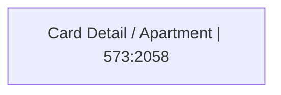

- Show details reveals sample credential face and changes label to Hide details; hide reverses. No sample card data copied to audit.

### J03 — Apartment Freeze

**FAIL · 2026-10-09 · approval not recorded · current app unverified**


- Click caused no visual or URL change. Fresh Plugin API inspection found no reaction on Freeze instance or descendants; other actions do have reactions.

### J04 — Apartment funding selection to pending and return

**PASS_WITH_FINDING · 2026-10-09 · approval not recorded · current app unverified**

```mermaid
flowchart LR
  step1["Card Detail / Apartment | 573:2058"]
  click step1 "https://www.figma.com/design/1hAy3kcZAEvqq8ZNjKU7CD?node-id=573%3A2058" "Open original screen"
  step2["Card / Fund card | 1151:5189"]
  click step2 "https://www.figma.com/design/1hAy3kcZAEvqq8ZNjKU7CD?node-id=1151%3A5189" "Open original screen"
  step3["Card / Review transfer | 1151:5263"]
  click step3 "https://www.figma.com/design/1hAy3kcZAEvqq8ZNjKU7CD?node-id=1151%3A5263" "Open original screen"
  step4["Card / Transfer pending | 1151:5290"]
  click step4 "https://www.figma.com/design/1hAy3kcZAEvqq8ZNjKU7CD?node-id=1151%3A5290" "Open original screen"
  step5["Card Detail / Apartment | 573:2058"]
  click step5 "https://www.figma.com/design/1hAy3kcZAEvqq8ZNjKU7CD?node-id=573%3A2058" "Open original screen"
  step1 -->|"Recorded next state"| step2
  step2 -->|"Recorded next state"| step3
  step3 -->|"Recorded next state"| step4
  step4 -->|"Recorded next state"| step5
```

- Selected $100 and Household checking; review preserved both and scoped one-time consent. Confirmation reached Pending, explicitly unavailable to spend, and Back to card returned Apartment.
- On this browser viewport, review and pending inherited prior scroll position, initially hiding heading and amount. Verify reset-scroll behavior.

### J05 — Taylor limit change, return, pause and restore

**PASS_WITH_FINDING · 2026-10-09 · approval not recorded · current app unverified**

```mermaid
flowchart LR
  step1["Card Detail / Apartment | 573:2058"]
  click step1 "https://www.figma.com/design/1hAy3kcZAEvqq8ZNjKU7CD?node-id=573%3A2058" "Open original screen"
  step2["Card Settings / Apartment | 622:2752"]
  click step2 "https://www.figma.com/design/1hAy3kcZAEvqq8ZNjKU7CD?node-id=622%3A2752" "Open original screen"
  step3["Role / hostPeople / Trusted Spenders | 1606:19916"]
  click step3 "https://www.figma.com/design/1hAy3kcZAEvqq8ZNjKU7CD?node-id=1606%3A19916" "Open original screen"
  step4["Role / hostPerson / Spender permissions | 1606:19992"]
  click step4 "https://www.figma.com/design/1hAy3kcZAEvqq8ZNjKU7CD?node-id=1606%3A19992" "Open original screen"
  step5["Role / editGrant / Spending permissions | 1606:20515"]
  click step5 "https://www.figma.com/design/1hAy3kcZAEvqq8ZNjKU7CD?node-id=1606%3A20515" "Open original screen"
  step6["Role / grant150 / Review permissions | 1606:20596"]
  click step6 "https://www.figma.com/design/1hAy3kcZAEvqq8ZNjKU7CD?node-id=1606%3A20596" "Open original screen"
  step7["Role / saved150 / Permissions updated | 1606:20758"]
  click step7 "https://www.figma.com/design/1hAy3kcZAEvqq8ZNjKU7CD?node-id=1606%3A20758" "Open original screen"
  step8["Role / pauseReview / Pause card access | 1606:20884"]
  click step8 "https://www.figma.com/design/1hAy3kcZAEvqq8ZNjKU7CD?node-id=1606%3A20884" "Open original screen"
  step9["Role / pauseDone / Card access paused | 1606:20960"]
  click step9 "https://www.figma.com/design/1hAy3kcZAEvqq8ZNjKU7CD?node-id=1606%3A20960" "Open original screen"
  step10["Role / restoreReview / Restore card access | 1606:21028"]
  click step10 "https://www.figma.com/design/1hAy3kcZAEvqq8ZNjKU7CD?node-id=1606%3A21028" "Open original screen"
  step1 -->|"Recorded next state"| step2
  step2 -->|"Recorded next state"| step3
  step3 -->|"Recorded next state"| step4
  step4 -->|"Recorded next state"| step5
  step5 -->|"Recorded next state"| step6
  step6 -->|"Recorded next state"| step7
  step7 -->|"Recorded next state"| step8
  step8 -->|"Recorded next state"| step9
  step9 -->|"Recorded next state"| step10
```

- Selected $150, review and success preserved it; returned through people list and reopened Taylor at $150. Pause and restore confirmation also retained $150 and Utilities; final permission screen was Active at $150.
- Static default $200 screenshots were not evidence of a reset bug: live variables preserved the chosen amount.
- Multiple transitions retained scroll position, hiding headings until scrolling up. Prototype behavior only; no real permissions changed.

### J06 — Introduction consent, sending, pending and withdrawal

**PASS · 2026-10-09 · approval not recorded · current app unverified**

```mermaid
flowchart LR
  step1["Continuation / request / Start with a conversation | 2012:31975"]
  click step1 "https://www.figma.com/design/1hAy3kcZAEvqq8ZNjKU7CD?node-id=2012%3A31975" "Open original screen"
  step2["Continuation / requestReady / Ready to say hello | 2012:32100"]
  click step2 "https://www.figma.com/design/1hAy3kcZAEvqq8ZNjKU7CD?node-id=2012%3A32100" "Open original screen"
  step3["Continuation / requestSending / Sending your request | 2012:32166"]
  click step3 "https://www.figma.com/design/1hAy3kcZAEvqq8ZNjKU7CD?node-id=2012%3A32166" "Open original screen"
  step4["Continuation / requestSent / Request sent | 2012:32215"]
  click step4 "https://www.figma.com/design/1hAy3kcZAEvqq8ZNjKU7CD?node-id=2012%3A32215" "Open original screen"
  step5["Continuation / pending / Waiting for Maya | 2012:32283"]
  click step5 "https://www.figma.com/design/1hAy3kcZAEvqq8ZNjKU7CD?node-id=2012%3A32283" "Open original screen"
  step6["Continuation / withdraw / Withdraw this request? | 2012:32348"]
  click step6 "https://www.figma.com/design/1hAy3kcZAEvqq8ZNjKU7CD?node-id=2012%3A32348" "Open original screen"
  step7["Continuation / withdrawn / Request withdrawn | 2012:32407"]
  click step7 "https://www.figma.com/design/1hAy3kcZAEvqq8ZNjKU7CD?node-id=2012%3A32407" "Open original screen"
  step1 -->|"Recorded next state"| step2
  step2 -->|"Recorded next state"| step3
  step3 -->|"Recorded next state"| step4
  step4 -->|"Recorded next state"| step5
  step5 -->|"Recorded next state"| step6
  step6 -->|"Recorded next state"| step7
```

- Consent enabled sending. Sending transitioned to pending confirmation; View request opened pending details; withdrawal opened confirmation and withdrawn outcome. No Circle membership or financial consent was represented.
- Figma Fit width and height resolved earlier viewer clipping. This did not establish unreachable product controls.

### J07 — Host accepts Alex and opens conversation

**PASS · 2026-10-09 · approval not recorded · current app unverified**

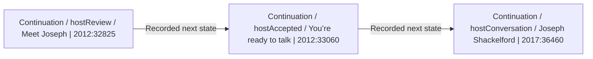

- Accept & open conversation led to accepted outcome, then Message Alex opened Alex Rivera conversation. Listing stayed open; no Circle membership was created. Stale node names mention Joseph but rendered actor was Alex.

### J08 — Blocked Inbox to housing conversation

**DESIGN_INCONSISTENCY · 2026-10-09 · approval not recorded · current app unverified**

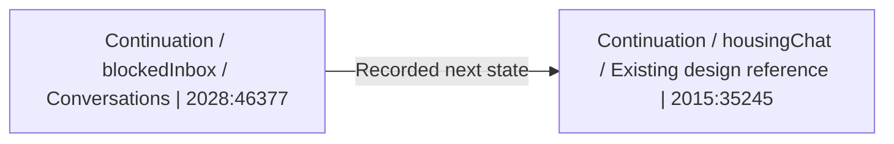

- Directly opened blocked Inbox fixture: Maya subscription marked Blocked / Read-only. Maple Street inquiry opened Maya Chen housing conversation with visible Write a message composer and no blocked label.
- This is inconsistent visual blocking across fixtures. No message send or backend bypass is claimed; person-wide block behavior needs reconciliation.

### J09 — Email sign-in shortcut

**FAIL · 2026-10-10 · approval not recorded · current app unverified**

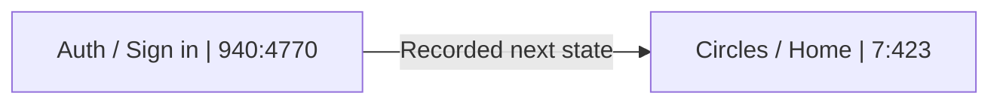

- Live Continue with the email field untouched navigated directly to populated Circles. Fresh Figma reactions target 7:423, bypassing the existing password screen 942:4800. This is prototype wiring only; not a demonstrated application authentication bypass.

### J10 — Password recovery confirmation and return

**PASS · 2026-10-10 · approval not recorded · current app unverified**

```mermaid
flowchart LR
  step1["Auth / Enter password | 942:4800"]
  click step1 "https://www.figma.com/design/1hAy3kcZAEvqq8ZNjKU7CD?node-id=942%3A4800" "Open original screen"
  step2["Auth / Reset password | 944:4812"]
  click step2 "https://www.figma.com/design/1hAy3kcZAEvqq8ZNjKU7CD?node-id=944%3A4812" "Open original screen"
  step3["Auth / Check inbox | 944:4941"]
  click step3 "https://www.figma.com/design/1hAy3kcZAEvqq8ZNjKU7CD?node-id=944%3A4941" "Open original screen"
  step4["Auth / Sign in | 940:4770"]
  click step4 "https://www.figma.com/design/1hAy3kcZAEvqq8ZNjKU7CD?node-id=940%3A4770" "Open original screen"
  step1 -->|"Recorded next state"| step2
  step2 -->|"Recorded next state"| step3
  step3 -->|"Recorded next state"| step4
```

- Forgot password opened reset; Continue opened Check your inbox with conditional account-existence-neutral copy. The settled screen displayed Back and Back to sign in, and the latter returned correctly. An early transition screenshot omitted these controls transiently; no missing-exit defect remains. No credentials entered or email sent.

### J11 — Circle Host handover request and cancellation

**PASS · 2026-10-10 · approval not recorded · current app unverified**

```mermaid
flowchart LR
  step1["Continuation / handover / Choose the next Circle Host | 2019:38862"]
  click step1 "https://www.figma.com/design/1hAy3kcZAEvqq8ZNjKU7CD?node-id=2019%3A38862" "Open original screen"
  step2["Continuation / handoverReview / Ask Jordan to become host? | 2019:38923"]
  click step2 "https://www.figma.com/design/1hAy3kcZAEvqq8ZNjKU7CD?node-id=2019%3A38923" "Open original screen"
  step3["Continuation / handoverPending / Jordan is reviewing your request | 2019:38973"]
  click step3 "https://www.figma.com/design/1hAy3kcZAEvqq8ZNjKU7CD?node-id=2019%3A38973" "Open original screen"
  step4["Continuation / circleAdmin / Movie night Circle | 2019:38309"]
  click step4 "https://www.figma.com/design/1hAy3kcZAEvqq8ZNjKU7CD?node-id=2019%3A38309" "Open original screen"
  step1 -->|"Recorded next state"| step2
  step2 -->|"Recorded next state"| step3
  step3 -->|"Recorded next state"| step4
```

- Selecting Jordan opened named review, request produced pending state explicitly retaining current host, cancellation returned to administration displaying You as Circle Host.

### J12 — Circle Host cannot leave before handover

**PASS · 2026-10-10 · approval not recorded · current app unverified**

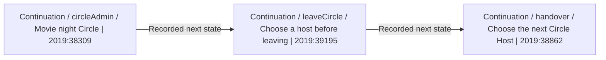

- Leave Circle routed to Choose a host before leaving, explained separate financial arrangements remain, and Choose next host opened existing selector.

### J13 — Jordan accepts Circle Host and retains actor context

**PASS · 2026-10-10 · approval not recorded · current app unverified**

```mermaid
flowchart LR
  step1["Continuation / handoverAccept / Become Circle Host? | 2019:39029"]
  click step1 "https://www.figma.com/design/1hAy3kcZAEvqq8ZNjKU7CD?node-id=2019%3A39029" "Open original screen"
  step2["Continuation / recipientJordanHostConfirmed / You’re now the Circle Host | 2038:42969"]
  click step2 "https://www.figma.com/design/1hAy3kcZAEvqq8ZNjKU7CD?node-id=2038%3A42969" "Open original screen"
  step3["Continuation / recipientJordanCircle / Movie night Circle | 2038:43023"]
  click step3 "https://www.figma.com/design/1hAy3kcZAEvqq8ZNjKU7CD?node-id=2038%3A43023" "Open original screen"
  step4["Continuation / recipientJordanHome / Your Circles | 2038:43084"]
  click step4 "https://www.figma.com/design/1hAy3kcZAEvqq8ZNjKU7CD?node-id=2038%3A43084" "Open original screen"
  step1 -->|"Recorded next state"| step2
  step2 -->|"Recorded next state"| step3
  step3 -->|"Recorded next state"| step4
```

- Recipient acceptance led to Jordan-specific confirmation, Circle and home; Jordan was You / Circle Host, Joseph remained a member. Copy retained separate Card/Bill ownership and accepted terms. Direct recipient fixture was used; no real invitation or permission was changed.

### J14 — Maya declines handover and returns

**FAIL · 2026-10-10 · approval not recorded · current app unverified**

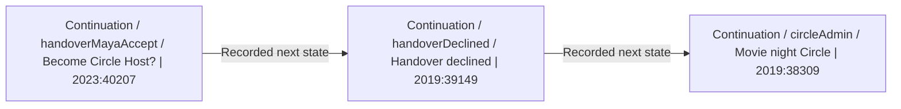

- Decline from Maya's recipient invitation opened shared decline outcome, then Back to Circle opened Joseph's host administration screen showing You're the Circle Host and host actions. Fresh source confirms the return is unconditional, rather than a missing deep-link actor initialization. This is prototype actor-context loss, not a backend authorization finding.

### J15 — Manual bill agreement, terms and bill return

**PASS_WITH_FINDING · 2026-10-10 · approval not recorded · current app unverified**

```mermaid
flowchart LR
  step1["Bill agreement / Review | 1330:10437"]
  click step1 "https://www.figma.com/design/1hAy3kcZAEvqq8ZNjKU7CD?node-id=1330%3A10437" "Open original screen"
  step2["Bill agreement / Manual | 1330:10511"]
  click step2 "https://www.figma.com/design/1hAy3kcZAEvqq8ZNjKU7CD?node-id=1330%3A10511" "Open original screen"
  step3["Bill agreement / Terms manual | 1330:10731"]
  click step3 "https://www.figma.com/design/1hAy3kcZAEvqq8ZNjKU7CD?node-id=1330%3A10731" "Open original screen"
  step4["Bill agreement / Manual | 1330:10511"]
  click step4 "https://www.figma.com/design/1hAy3kcZAEvqq8ZNjKU7CD?node-id=1330%3A10511" "Open original screen"
  step5["Bill agreement / Ready manual | 1330:10657"]
  click step5 "https://www.figma.com/design/1hAy3kcZAEvqq8ZNjKU7CD?node-id=1330%3A10657" "Open original screen"
  step6["Bill Detail / Groceries | 714:3018"]
  click step6 "https://www.figma.com/design/1hAy3kcZAEvqq8ZNjKU7CD?node-id=714%3A3018" "Open original screen"
  step1 -->|"Recorded next state"| step2
  step2 -->|"Recorded next state"| step3
  step3 -->|"Recorded next state"| step4
  step4 -->|"Recorded next state"| step5
  step5 -->|"Recorded next state"| step6
```

- Review retained $18/week, Thursday, September 17, 2026 start and until-canceled duration. Manual selected by default; full terms require confirming every payment, separate material-change acceptance and no Circle/Card/spending grant. Accepted outcome explicitly says nothing paid yet; bill remains Manual.
- Identity inconsistency: invitation describes Apartment crew, but View bill opens Groceries under Family circle. Amount, host Maya and schedule match.

### J16 — Groceries manual contribution review to pending

**PASS_WITH_FINDING · 2026-10-10 · approval not recorded · current app unverified**

```mermaid
flowchart LR
  step1["Bill Detail / Groceries | 714:3018"]
  click step1 "https://www.figma.com/design/1hAy3kcZAEvqq8ZNjKU7CD?node-id=714%3A3018" "Open original screen"
  step2["Role / gPay / Review contribution | 1608:21500"]
  click step2 "https://www.figma.com/design/1hAy3kcZAEvqq8ZNjKU7CD?node-id=1608%3A21500" "Open original screen"
  step3["Role / gPending / Contribution pending | 1608:21569"]
  click step3 "https://www.figma.com/design/1hAy3kcZAEvqq8ZNjKU7CD?node-id=1608%3A21569" "Open original screen"
  step4["Role / gAgreement / Your agreement | 1608:21376"]
  click step4 "https://www.figma.com/design/1hAy3kcZAEvqq8ZNjKU7CD?node-id=1608%3A21376" "Open original screen"
  step1 -->|"Recorded next state"| step2
  step2 -->|"Recorded next state"| step3
  step3 -->|"Recorded next state"| step4
```

- Review scoped one-time $18 transfer from selected checking to Groceries. Pending explicitly said not yet received and excluded settlement. Back to agreement retained $18 Manual.
- The return still offers Review contribution with no pending occurrence marker; duplicate-attempt prevention is not modeled by this fixture. No backend transfer or idempotency result is claimed.

### J17 — Stop future grocery contributions and revisit through history

**FAIL · 2026-10-10 · approval not recorded · current app unverified**

```mermaid
flowchart LR
  step1["Role / gAgreement / Your agreement | 1608:21376"]
  click step1 "https://www.figma.com/design/1hAy3kcZAEvqq8ZNjKU7CD?node-id=1608%3A21376" "Open original screen"
  step2["Role / gStop / Stop contributions | 1608:21635"]
  click step2 "https://www.figma.com/design/1hAy3kcZAEvqq8ZNjKU7CD?node-id=1608%3A21635" "Open original screen"
  step3["Role / gStopped / Contributions stopped | 1608:21701"]
  click step3 "https://www.figma.com/design/1hAy3kcZAEvqq8ZNjKU7CD?node-id=1608%3A21701" "Open original screen"
  step4["Role / gHistory / Contribution history | 1608:21441"]
  click step4 "https://www.figma.com/design/1hAy3kcZAEvqq8ZNjKU7CD?node-id=1608%3A21441" "Open original screen"
  step5["Role / gAgreement / Your agreement | 1608:21376"]
  click step5 "https://www.figma.com/design/1hAy3kcZAEvqq8ZNjKU7CD?node-id=1608%3A21376" "Open original screen"
  step1 -->|"Recorded next state"| step2
  step2 -->|"Recorded next state"| step3
  step3 -->|"Recorded next state"| step4
  step4 -->|"Recorded next state"| step5
```

- Review and stopped outcome correctly preserve past payments, pending transfers and separate Circle/Card access. History remains reachable.
- View agreement from history returned to original ongoing agreement with Next due September 17, Stop future contributions and Review contribution, without ended status. History showed only older received rows and omitted the pending transfer just created in this prototype path. State continuity is incomplete; not a real transfer or data-loss finding.

### J18 — Automatic agreement source selection, terms and bill return

**FAIL · 2026-10-10 · approval not recorded · current app unverified**

```mermaid
flowchart LR
  step1["Bill agreement / Manual | 1330:10511"]
  click step1 "https://www.figma.com/design/1hAy3kcZAEvqq8ZNjKU7CD?node-id=1330%3A10511" "Open original screen"
  step2["Bill agreement / Automatic | 1330:10587"]
  click step2 "https://www.figma.com/design/1hAy3kcZAEvqq8ZNjKU7CD?node-id=1330%3A10587" "Open original screen"
  step3["Bill agreement / Accounts | 1330:10825"]
  click step3 "https://www.figma.com/design/1hAy3kcZAEvqq8ZNjKU7CD?node-id=1330%3A10825" "Open original screen"
  step4["Bill agreement / Automatic | 1330:10587"]
  click step4 "https://www.figma.com/design/1hAy3kcZAEvqq8ZNjKU7CD?node-id=1330%3A10587" "Open original screen"
  step5["Bill agreement / Terms automatic | 1330:10778"]
  click step5 "https://www.figma.com/design/1hAy3kcZAEvqq8ZNjKU7CD?node-id=1330%3A10778" "Open original screen"
  step6["Bill agreement / Automatic | 1330:10587"]
  click step6 "https://www.figma.com/design/1hAy3kcZAEvqq8ZNjKU7CD?node-id=1330%3A10587" "Open original screen"
  step7["Bill agreement / Ready automatic | 1330:10694"]
  click step7 "https://www.figma.com/design/1hAy3kcZAEvqq8ZNjKU7CD?node-id=1330%3A10694" "Open original screen"
  step8["Bill Detail / Groceries | 714:3018"]
  click step8 "https://www.figma.com/design/1hAy3kcZAEvqq8ZNjKU7CD?node-id=714%3A3018" "Open original screen"
  step1 -->|"Recorded next state"| step2
  step2 -->|"Recorded next state"| step3
  step3 -->|"Recorded next state"| step4
  step4 -->|"Recorded next state"| step5
  step5 -->|"Recorded next state"| step6
  step6 -->|"Recorded next state"| step7
  step7 -->|"Recorded next state"| step8
```

- Automatic was an explicit choice. Household checking selected in Accounts persisted in full recurring terms and the scheduled result; fixed amount/frequency/start/cancel terms were present and nothing was marked paid.
- View bill then opened 714:3018, which says Manual and You initiate each weekly contribution. The scheduled-versus-manual choice is lost in the return presentation. No live debit mandate was created.

### J19 — Failed transfer retry with changed funding account

**PASS_WITH_FINDING · 2026-10-10 · approval not recorded · current app unverified**

```mermaid
flowchart LR
  step1["Bill help / Transfer unsuccessful | 1375:11314"]
  click step1 "https://www.figma.com/design/1hAy3kcZAEvqq8ZNjKU7CD?node-id=1375%3A11314" "Open original screen"
  step2["Bill payment / Review | 1348:10898"]
  click step2 "https://www.figma.com/design/1hAy3kcZAEvqq8ZNjKU7CD?node-id=1348%3A10898" "Open original screen"
  step3["Bill agreement / Accounts | 1330:10825"]
  click step3 "https://www.figma.com/design/1hAy3kcZAEvqq8ZNjKU7CD?node-id=1330%3A10825" "Open original screen"
  step4["Bill payment / Review | 1348:10898"]
  click step4 "https://www.figma.com/design/1hAy3kcZAEvqq8ZNjKU7CD?node-id=1348%3A10898" "Open original screen"
  step5["Bill payment / Pending | 1348:10951"]
  click step5 "https://www.figma.com/design/1hAy3kcZAEvqq8ZNjKU7CD?node-id=1348%3A10951" "Open original screen"
  step6["Bill payment / Pending details | 1348:11048"]
  click step6 "https://www.figma.com/design/1hAy3kcZAEvqq8ZNjKU7CD?node-id=1348%3A11048" "Open original screen"
  step7["Bill Detail / Groceries | 714:3018"]
  click step7 "https://www.figma.com/design/1hAy3kcZAEvqq8ZNjKU7CD?node-id=714%3A3018" "Open original screen"
  step1 -->|"Recorded next state"| step2
  step2 -->|"Recorded next state"| step3
  step3 -->|"Recorded next state"| step4
  step4 -->|"Recorded next state"| step5
  step5 -->|"Recorded next state"| step6
  step6 -->|"Recorded next state"| step7
```

- An unsuccessful transfer leads to a fresh one-time $18 review, not an immediate retry. Choosing Household checking returns to the correct review and persists through the pending outcome and contribution details. Pending screens explicitly distinguish initiated from received and discourage another payment.
- Back to bill loses the pending occurrence and changes Apartment crew to Family circle; the bill again offers Review contribution. Same shared static-bill destination issue as the earlier agreement checks. No real transfer or backend duplicate-payment behavior was tested.

### J20 — Above-maximum one-occurrence approval

**PASS_WITH_FINDING · 2026-10-10 · approval not recorded · current app unverified**

```mermaid
flowchart LR
  step1["Bill change / Above maximum | 1375:11740"]
  click step1 "https://www.figma.com/design/1hAy3kcZAEvqq8ZNjKU7CD?node-id=1375%3A11740" "Open original screen"
  step2["Bill change / Updated terms | 1377:13017"]
  click step2 "https://www.figma.com/design/1hAy3kcZAEvqq8ZNjKU7CD?node-id=1377%3A13017" "Open original screen"
  step3["Bill change / Result | 1377:13061"]
  click step3 "https://www.figma.com/design/1hAy3kcZAEvqq8ZNjKU7CD?node-id=1377%3A13061" "Open original screen"
  step4["Bill help / Needs attention | 1375:11172"]
  click step4 "https://www.figma.com/design/1hAy3kcZAEvqq8ZNjKU7CD?node-id=1375%3A11172" "Open original screen"
  step1 -->|"Recorded next state"| step2
  step2 -->|"Recorded next state"| step3
  step3 -->|"Recorded next state"| step4
```

- Electric proposes $29 versus an accepted $25 maximum. Terms and outcome preserve a one-occurrence exception, manual payment and the ongoing $25 maximum. Acceptance does not claim payment.
- Needs attention still shows the same unapproved Electric task after approval. Static attention fixture does not reflect completed actions; also retains the preceding unsuccessful-transfer task after a simulated pending retry.

### J21 — Disconnected funding account and alternate-account review

**PASS_WITH_FINDING · 2026-10-10 · approval not recorded · current app unverified**

```mermaid
flowchart LR
  step1["Bill help / Needs attention | 1375:11172"]
  click step1 "https://www.figma.com/design/1hAy3kcZAEvqq8ZNjKU7CD?node-id=1375%3A11172" "Open original screen"
  step2["Bill help / Reconnect account | 1375:11413"]
  click step2 "https://www.figma.com/design/1hAy3kcZAEvqq8ZNjKU7CD?node-id=1375%3A11413" "Open original screen"
  step3["Bill help / Secure bank connection | 1377:13092"]
  click step3 "https://www.figma.com/design/1hAy3kcZAEvqq8ZNjKU7CD?node-id=1377%3A13092" "Open original screen"
  step4["Bill help / Choose eligible account | 1378:13204"]
  click step4 "https://www.figma.com/design/1hAy3kcZAEvqq8ZNjKU7CD?node-id=1378%3A13204" "Open original screen"
  step5["Bill change / Updated terms | 1377:13017"]
  click step5 "https://www.figma.com/design/1hAy3kcZAEvqq8ZNjKU7CD?node-id=1377%3A13017" "Open original screen"
  step6["Bill change / Result | 1377:13061"]
  click step6 "https://www.figma.com/design/1hAy3kcZAEvqq8ZNjKU7CD?node-id=1377%3A13061" "Open original screen"
  step1 -->|"Recorded next state"| step2
  step2 -->|"Recorded next state"| step3
  step3 -->|"Recorded next state"| step4
  step4 -->|"Recorded next state"| step5
  step5 -->|"Recorded next state"| step6
```

- Reconnection is explicitly separate from payment. The secure-bank handoff frame is a prototype boundary, not a functioning provider flow. Choosing Household checking from eligible accounts changes the shared terms frame to the correct Phone plan ($32 monthly), preserves the account and requires explicit acceptance. Outcome says funding account updated and nothing paid.
- The secure-bank frame contains implementation/prototype explanatory copy in the user screen. Reconcile this against the user's final-product UI direction before implementation; do not fabricate a real bank connection.

### J22 — Card appearance choice and standalone review

**FAIL · 2026-10-10 · approval not recorded · current app unverified**

```mermaid
flowchart LR
  step1["Create Card / Details | 854:3466"]
  click step1 "https://www.figma.com/design/1hAy3kcZAEvqq8ZNjKU7CD?node-id=854%3A3466" "Open original screen"
  step2["Create Card / Choose appearance | 928:4751"]
  click step2 "https://www.figma.com/design/1hAy3kcZAEvqq8ZNjKU7CD?node-id=928%3A4751" "Open original screen"
  step3["Create Card / Attach Circle | 854:3495"]
  click step3 "https://www.figma.com/design/1hAy3kcZAEvqq8ZNjKU7CD?node-id=854%3A3495" "Open original screen"
  step4["Create Card / Review / No Circle | 861:3572"]
  click step4 "https://www.figma.com/design/1hAy3kcZAEvqq8ZNjKU7CD?node-id=861%3A3572" "Open original screen"
  step5["Create Card / Attach Circle | 854:3495"]
  click step5 "https://www.figma.com/design/1hAy3kcZAEvqq8ZNjKU7CD?node-id=854%3A3495" "Open original screen"
  step1 -->|"Recorded next state"| step2
  step2 -->|"Recorded next state"| step3
  step3 -->|"Recorded next state"| step4
  step4 -->|"Recorded next state"| step5
```

- The picker visibly changes to Evergreen solid, but No Circle review returns to the Northern lights Apartment card. The picker also displays Trip card and a different example balance instead of the creation screen's Apartment card. Fresh source confirms the appearance tile sets VariableID:1081:5549; review does not visibly preserve it.
- No Circle correctly opens the dedicated standalone review immediately. Back then shows Apartment crew selected again. Treat these as prototype draft-state discontinuities; do not substitute invented screens or fabricate balances in the app.

### J23 — Create Circle interruption within Card setup

**FAIL · 2026-10-10 · approval not recorded · current app unverified**

```mermaid
flowchart LR
  step1["Create Card / Attach Circle | 854:3495"]
  click step1 "https://www.figma.com/design/1hAy3kcZAEvqq8ZNjKU7CD?node-id=854%3A3495" "Open original screen"
  step2["Create Circle / New Circle | 335:506"]
  click step2 "https://www.figma.com/design/1hAy3kcZAEvqq8ZNjKU7CD?node-id=335%3A506" "Open original screen"
  step3["Add People Overlay - Closed | 488:1134"]
  click step3 "https://www.figma.com/design/1hAy3kcZAEvqq8ZNjKU7CD?node-id=488%3A1134" "Open original screen"
  step4["Create Circle / People Selected | 542:1632"]
  click step4 "https://www.figma.com/design/1hAy3kcZAEvqq8ZNjKU7CD?node-id=542%3A1632" "Open original screen"
  step5["Circles / Home | 7:423"]
  click step5 "https://www.figma.com/design/1hAy3kcZAEvqq8ZNjKU7CD?node-id=7%3A423" "Open original screen"
  step1 -->|"Recorded next state"| step2
  step2 -->|"Recorded next state"| step3
  step3 -->|"Recorded next state"| step4
  step4 -->|"Recorded next state"| step5
```

- Create a new Circle opens the existing Circle form and Add people overlay. Clicking Maya Add changes the fixture to three invited people (Jordan, Maya, Taylor), rather than just Maya.
- The enabled-looking Create Circle action has no effect. Fresh source confirms I542:1632;542:1565 and its label have no reaction; only Back, Add person and switches are wired on this screen.
- Back navigates to Circles home instead of returning to the interrupted Card draft. The name remained a placeholder, so no claim is made that a valid completed form was accepted. The intended embedded return and validation path are not executable in this prototype.

### J24 — Known category retained with optional category editing

**PASS_WITH_FINDING · 2026-10-10 · approval not recorded · current app unverified**

```mermaid
flowchart LR
  step1["Continuation / chooseService / What would you like to share? | 2016:35940"]
  click step1 "https://www.figma.com/design/1hAy3kcZAEvqq8ZNjKU7CD?node-id=2016%3A35940" "Open original screen"
  step2["Continuation / phoneProviderPicker / Which provider? | 2093:44342"]
  click step2 "https://www.figma.com/design/1hAy3kcZAEvqq8ZNjKU7CD?node-id=2093%3A44342" "Open original screen"
  step3["Continuation / customService / Make it yours | 2016:36046"]
  click step3 "https://www.figma.com/design/1hAy3kcZAEvqq8ZNjKU7CD?node-id=2016%3A36046" "Open original screen"
  step4["Continuation / customOther / Choose a category | 2016:36112"]
  click step4 "https://www.figma.com/design/1hAy3kcZAEvqq8ZNjKU7CD?node-id=2016%3A36112" "Open original screen"
  step5["Continuation / customService / Make it yours | 2016:36046"]
  click step5 "https://www.figma.com/design/1hAy3kcZAEvqq8ZNjKU7CD?node-id=2016%3A36046" "Open original screen"
  step6["Continuation / customArrangement / Set clear expectations | 2016:36163"]
  click step6 "https://www.figma.com/design/1hAy3kcZAEvqq8ZNjKU7CD?node-id=2016%3A36163" "Open original screen"
  step1 -->|"Recorded next state"| step2
  step2 -->|"Recorded next state"| step3
  step3 -->|"Recorded next state"| step4
  step4 -->|"Recorded next state"| step5
  step5 -->|"Recorded next state"| step6
```

- Phone plans > Another provider opens Make it yours with Phone plan already chosen. Change category is optional; choosing Membership updates the category and preserves existing service text. Continue goes directly to arrangement with no mandatory second category prompt.
- The selected Phone plan initially uses the membership/basket icon rather than the phone icon on the picker. Existing service text staying intact after an explicit category edit is not itself a defect. No app behavior was tested.

### J25 — Failed-message edit and resend

**PASS · 2026-10-10 · approval not recorded · current app unverified**

```mermaid
flowchart LR
  step1["Continuation / messageFailed / Maya Chen | 2017:36400"]
  click step1 "https://www.figma.com/design/1hAy3kcZAEvqq8ZNjKU7CD?node-id=2017%3A36400" "Open original screen"
  step2["Continuation / Overlay / Message actions / Closed | 2060:43022"]
  click step2 "https://www.figma.com/design/1hAy3kcZAEvqq8ZNjKU7CD?node-id=2060%3A43022" "Open original screen"
  step3["Continuation / Overlay / Message actions / Open | 2060:43035"]
  click step3 "https://www.figma.com/design/1hAy3kcZAEvqq8ZNjKU7CD?node-id=2060%3A43035" "Open original screen"
  step4["Continuation / messageReady / Message Maya | 2017:36280"]
  click step4 "https://www.figma.com/design/1hAy3kcZAEvqq8ZNjKU7CD?node-id=2017%3A36280" "Open original screen"
  step5["Continuation / messageSent / Maya Chen | 2017:36337"]
  click step5 "https://www.figma.com/design/1hAy3kcZAEvqq8ZNjKU7CD?node-id=2017%3A36337" "Open original screen"
  step1 -->|"Recorded next state"| step2
  step2 -->|"Recorded next state"| step3
  step3 -->|"Recorded next state"| step4
  step4 -->|"Recorded next state"| step5
```

- The red ! beside the failed bubble opens Message not sent actions. Edit message restores the same text in the composer; simulated send displays it once as Delivered and clears the composer. All activity stayed in the Figma prototype, not a real conversation.
- Direct Try again, Cancel, outside dismissal and generic-icon variant were not exercised in this check.

### J26 — Weekly target Goal to proposal review

**FAIL · 2026-10-10 · approval not recorded · current app unverified**

```mermaid
flowchart LR
  step1["Create Goal / Details | 793:3211"]
  click step1 "https://www.figma.com/design/1hAy3kcZAEvqq8ZNjKU7CD?node-id=793%3A3211" "Open original screen"
  step2["Goal / Charge schedule | 801:3363"]
  click step2 "https://www.figma.com/design/1hAy3kcZAEvqq8ZNjKU7CD?node-id=801%3A3363" "Open original screen"
  step3["Goal / Charge schedule / Weekly | 812:3426"]
  click step3 "https://www.figma.com/design/1hAy3kcZAEvqq8ZNjKU7CD?node-id=812%3A3426" "Open original screen"
  step4["Goal / Attach Circle | 812:3466"]
  click step4 "https://www.figma.com/design/1hAy3kcZAEvqq8ZNjKU7CD?node-id=812%3A3466" "Open original screen"
  step5["Goal / Attach Card | 839:3372"]
  click step5 "https://www.figma.com/design/1hAy3kcZAEvqq8ZNjKU7CD?node-id=839%3A3372" "Open original screen"
  step6["Goal / Monthly contribution | 801:3313"]
  click step6 "https://www.figma.com/design/1hAy3kcZAEvqq8ZNjKU7CD?node-id=801%3A3313" "Open original screen"
  step7["Create Goal / Review | 793:3292"]
  click step7 "https://www.figma.com/design/1hAy3kcZAEvqq8ZNjKU7CD?node-id=793%3A3292" "Open original screen"
  step8["Circles / Home | 7:423"]
  click step8 "https://www.figma.com/design/1hAy3kcZAEvqq8ZNjKU7CD?node-id=7%3A423" "Open original screen"
  step1 -->|"Recorded next state"| step2
  step2 -->|"Recorded next state"| step3
  step3 -->|"Recorded next state"| step4
  step4 -->|"Recorded next state"| step5
  step5 -->|"Recorded next state"| step6
  step6 -->|"Recorded next state"| step7
  step7 -->|"Recorded next state"| step8
```

- The target-$1200 flow permits selecting Weekly/Monday, then proceeds through Circle and Card attachment. Allocation and review instead say monthly, with September 1 first charge; the selected frequency is lost. Review still correctly labels the arrangement Draft and says each person accepts their own contribution.
- Create goal returns to the fixed Circles home without showing the new goal or proposal outcome. Attach to card is not itself a confirmed authority conflict: PRODUCT_CONTEXT preserves existing Goal planning and the Circle-then-Card attachment model while deferring Goals workspace relocation.
- A temporarily missing footer reappeared after scrolling/repaint; it was not recorded as an absent-screen defect. No actual recurring contribution was created.
